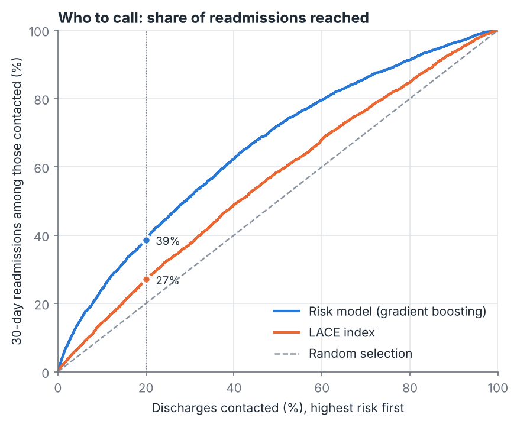
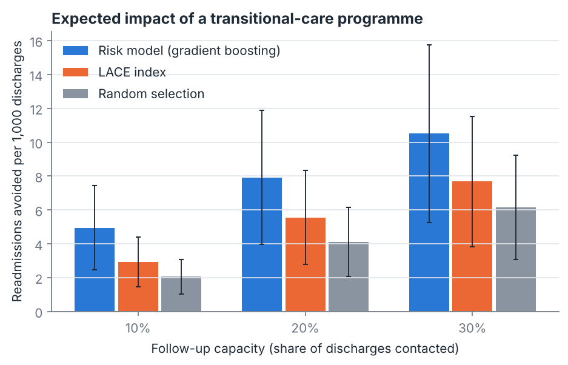
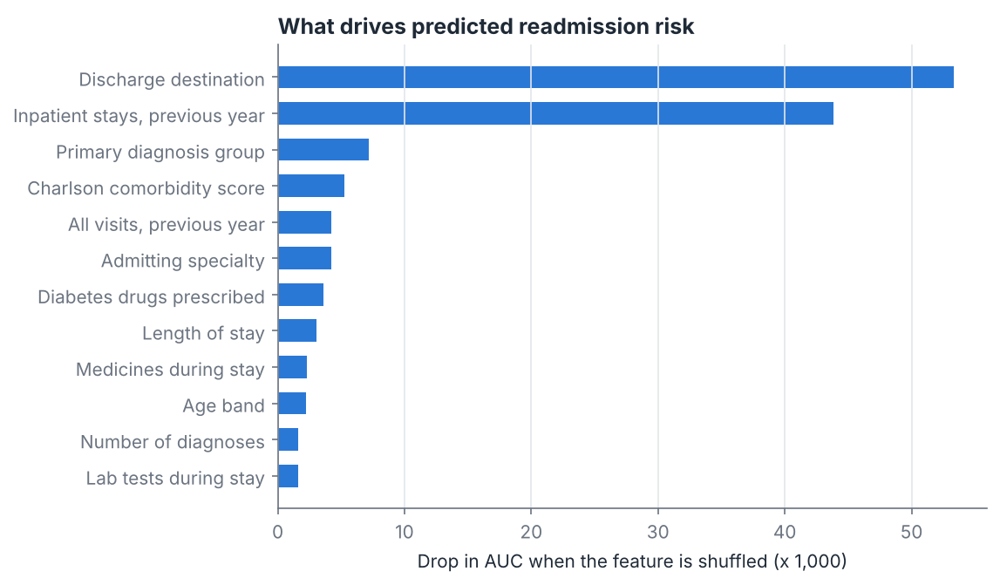
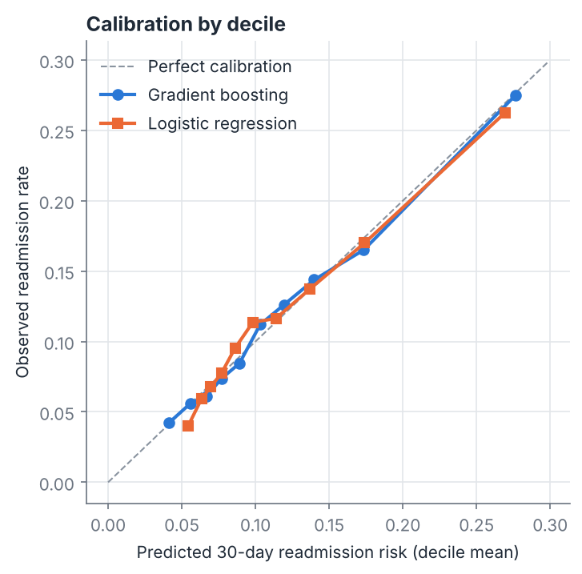

# Hospital Readmission Risk

**Who should a care team call after discharge?** A 30-day readmission risk model for patients with diabetes, built and validated the way a hospital analytics team would. It has a SQL clinical feature layer, the LACE index as the current-practice benchmark, patient-level validation, a capacity and impact analysis, and equity monitoring.

[](https://github.com/Youssef-Remmal-tech/hospital-readmission-risk/actions/workflows/ci.yml)
  

**[Capacity planner (interactive)](https://youssef-remmal-tech.github.io/hospital-readmission-risk/)** · **[Model card](reports/model_card.md)** · **[Notebook walkthrough](notebooks/walkthrough.ipynb)**

---

## The answer in 30 seconds

A follow-up team that can contact **20% of discharged patients** reaches:

| Who gets the call | Readmissions reached | Readmissions avoided per 1,000 discharges* | Calls per readmission avoided |
|---|---|---|---|
| **Risk model (this project)** | **38.6%** | **7.9** (4.0–11.9) | **25** |
| LACE index (common practice) | 27.0% | 5.5 (2.8–8.3) | 36 |
| Random or first-come | 20.0% | 4.1 (2.1–6.2) | 49 |

\*Assumes the follow-up programme cuts readmission risk by 18% (range 9–27%) for the patients contacted. That figure is the pooled effect of transitional-care interventions across 42 randomised trials ([Leppin et al., 2014](https://jamanetwork.com/journals/jamainternalmedicine/fullarticle/1868538)).

- **Same staff time, 43% more readmissions prevented than LACE.** Every call is better spent: 25 calls per readmission avoided instead of 36.
- **The model beats LACE by 0.107 AUC** (0.675 vs 0.568, patient-clustered 95% CI 0.094 to 0.121).
- **Its risk estimates can be trusted as probabilities.** Predicted and observed readmission rates match within 1 percentage point in every decile.
- **Results come from 20,997 patients the model never saw.** The split is by patient, not by admission.

## Business problem

Emergency readmission within 30 days of discharge is a standard measure of hospital quality. It appears in the NHS Outcomes Framework and in the US Hospital Readmissions Reduction Program. Readmissions are costly and often preventable with follow-up calls, medication reviews and early clinic appointments. But those interventions take staff time, and no team can reach every patient.

The real question is **which patients to contact first**. Many hospitals answer it with the LACE index, a four-item score. This project tests whether a model built on routinely recorded hospital data can direct the same capacity to more of the patients who will actually be readmitted. It then turns the answer into the number a service manager plans with: readmissions avoided per year.

## Data

[UCI Diabetes 130-US Hospitals, 1999–2008](https://archive.ics.uci.edu/dataset/296/diabetes+130-us+hospitals+for+years+1999-2008) (Strack et al., 2014), CC BY 4.0. The dataset is de-identified by the original authors.

| | |
|---|---|
| Encounters in source | 101,766 (71,518 patients) |
| Removed: discharges to death or hospice | 2,423 (cannot be readmitted) |
| Analysed | **99,343 discharges, 69,990 patients** |
| 30-day readmission rate | 11.4% |
| Training / hold-out | 69,519 / 29,824 discharges, split by patient |

## Approach

```
data/raw/diabetic_data.csv.gz
        │
        ▼  sql/01_staging.sql    "?" → NULL, remove death and hospice discharges, typed columns
        ▼  sql/02_features.sql   ICD-9 → diagnosis groups; Charlson comorbidity score (Deyo codes);
        │                        LACE index; medication and dose-change features
        ▼  sql/03_checks.sql     data-quality gates
        │
        ▼  src/models.py         logistic regression and gradient boosting, tuned with GroupKFold
        ▼  src/evaluate.py       AUC, average precision, calibration, patient-clustered bootstrap,
                                 capacity table, impact per 1,000 discharges, equity by group
```

**1. Clinical features in SQL.** Diagnosis codes are unpivoted and mapped to Charlson comorbidity conditions using the Deyo ICD-9 definitions with LACE weights. The severe form of a condition replaces the mild form; for example, metastatic cancer replaces a primary tumour. The LACE index is computed from length of stay, emergency admission, comorbidity and prior emergency visits, using the published points table ([van Walraven et al., 2010](https://www.cmaj.ca/content/182/6/551)).

**2. Validation that matches real use.** 30% of patients go into a hold-out set, so the same person is never in both samples. Hyperparameters are tuned with patient-grouped 5-fold cross-validation.

**3. Three ways to choose who to call.** The candidates are gradient boosting (recommended), logistic regression (interpretable alternative) and LACE (current practice). Each is scored on the same hold-out discharges.

**4. From AUC to readmissions avoided.** For each capacity level the analysis counts how many future readmissions fall in the contacted group. It then applies the evidence-based intervention effect, with its confidence range.

**5. Equity by design.** Race and gender are excluded from the model inputs and used only to check outcomes by group.

## Results

All figures are on the 29,824 hold-out discharges (20,997 patients, 3,398 readmissions).

| Model | AUC (95% CI) | Average precision | Brier score |
|---|---|---|---|
| **Gradient boosting** | **0.675** (0.663–0.687) | **0.231** | **0.096** |
| Logistic regression | 0.665 (0.654–0.677) | 0.211 | 0.097 |
| LACE index | 0.568 (0.557–0.579) | 0.138 | n/a |

- Gradient boosting beats LACE by **+0.107 AUC** (95% CI 0.094–0.121) and logistic regression by **+0.010** (95% CI 0.006–0.014). Both differences come from a patient-clustered paired bootstrap with 1,000 resamples.
- Readmission is hard to predict from discharge records alone, because they cannot see social support, frailty or what happens after the patient leaves. That is why the absolute AUCs are modest and the comparison with LACE is the meaningful result.

<p float="left">


</p>

The error bars on the right show the 95% confidence range of the intervention effect (RR 0.73 to 0.91), not sampling error.

### Capacity table

| Capacity | Model reaches | LACE reaches | Avoided per 1,000 (model) | Avoided per 1,000 (LACE) |
|---|---|---|---|---|
| 10% | 24.1% | 14.3% | 4.9 | 2.9 |
| 20% | 38.6% | 27.0% | 7.9 | 5.5 |
| 30% | 51.2% | 37.4% | 10.5 | 7.7 |

Full table, including logistic regression and lift: [`outputs/tables/capacity_and_impact.csv`](outputs/tables/capacity_and_impact.csv).

### What drives risk

<p float="left">


</p>

- **Discharge destination and inpatient stays in the previous year** dominate. Shuffling either one cuts AUC by 0.053 and 0.044 respectively.
- After those come the primary diagnosis group and the Charlson comorbidity score.
- Both models are well calibrated. For gradient boosting, the top decile predicts 27.6% and observes 27.5%, and no decile is off by more than 1 percentage point.

### Equity check at 20% capacity

| Group | Discharges | Readmission rate | Mean predicted risk | Readmissions caught |
|---|---|---|---|---|
| African American | 5,595 | 11.1% | 11.4% | 38.5% |
| Caucasian | 22,340 | 11.6% | 11.5% | 39.2% |
| Hispanic | 608 | 10.9% | 10.1% | 31.8% |
| Asian | 217 | 8.8% | 9.8% | 26.3% |
| Female | 16,154 | 11.5% | 11.8% | 41.5% |
| Male | 13,670 | 11.2% | 11.0% | 35.1% |
| Age 70+ | 13,288 | 12.1% | 12.2% | 37.4% |

- **Calibration holds in every group.** Mean predicted risk is within 1.2 percentage points of the observed rate.
- **Capture is lower for Hispanic and Asian patients and for men.** For Hispanic and Asian patients, small numbers (608 and 217) make those estimates noisy, so the gap should be monitored before acting on it. Full table: [`outputs/tables/equity_monitoring.csv`](outputs/tables/equity_monitoring.csv).

### Leakage check

The analysis was re-run with admissions split at random instead of by patient. Under that split, 38.6% of hold-out patients also appear in training. AUC rises only from 0.675 to 0.678, so the patient-level result does not depend on recognising returning patients.

## Key decisions

| Decision | Why | Cost |
|---|---|---|
| Split by patient, not admission | A deployed model scores new patients, so the test should too | Slightly lower reported AUC |
| LACE as the benchmark | It is what many hospitals already use, so it is the bar to beat | None |
| Impact in readmissions avoided, using a published effect size | Managers plan with staff time and outcomes, not AUC | Assumes the trial effect transfers; shown as a range |
| Race and gender excluded from inputs | Avoids encoding group membership into who gets care | Monitored by group instead |
| Death and hospice discharges removed | These patients cannot be readmitted | 2,423 encounters |

## How to run

```bash
git clone https://github.com/Youssef-Remmal-tech/hospital-readmission-risk.git
cd hospital-readmission-risk
python -m venv .venv && source .venv/bin/activate      # Windows: .venv\Scripts\activate
pip install -r requirements.txt
python run_pipeline.py      # about 5 minutes: features, tuning, validation, tables, charts
pytest -q                   # 11 tests: row counts, exclusions, Charlson and LACE scoring, capacity maths
```

## Project structure

```
├── sql/                    DuckDB SQL: staging, clinical features (Charlson, LACE), data-quality checks
├── src/
│   ├── config.py           settings: features, capacity levels, intervention effect and its source
│   ├── build_features.py   runs the SQL, verifies the raw-file checksum
│   ├── models.py           logistic regression, gradient boosting, odds ratios
│   ├── evaluate.py         metrics, patient-clustered bootstrap, capacity, impact, equity
│   └── plots.py            README charts
├── tests/                  pytest suite
├── notebooks/              walkthrough.ipynb, executed
├── reports/                model_card.md: intended use, performance, limitations
├── outputs/                figures, CSV tables, metrics.json
├── docs/                   interactive capacity planner (GitHub Pages)
├── data/raw/               UCI source file (CC BY 4.0)
└── run_pipeline.py         one command, end to end
```

## Limitations

- **US data from 1999–2008.** Coding, care pathways and readmission rates have changed. The model would need retraining and validation on local, current data, such as Hospital Episode Statistics in the NHS.
- **Diabetic inpatients only,** with stays of 1 to 14 days.
- **Only three diagnosis codes per stay.** The Charlson score, and therefore LACE, is under-counted compared with full coding, which partly explains LACE's low AUC here.
- **The prior-emergency count covers the previous year,** where LACE specifies 6 months.
- **Readmissions to other hospitals** may be missing from the source.
- **The impact estimate assumes the trial effect applies equally to every contacted patient.** Interventions may work better or worse for the highest-risk patients.

## What I'd do next

- Re-fit on NHS Hospital Episode Statistics with a time-based split and report it against the NHS emergency readmission indicator
- Run a silent pilot that scores live discharges without acting on them, and compare capture with LACE prospectively
- Add social and frailty data (living alone, care package, frailty score), which discharge-record models cannot see
- Build a Power BI ward view: the daily discharge list ranked by risk, with the top drivers for each patient

## References

- Strack, B. et al. (2014). Impact of HbA1c measurement on hospital readmission rates: analysis of 70,000 clinical database patient records. *BioMed Research International*, 2014, 781670.
- Leppin, A. L. et al. (2014). Preventing 30-day hospital readmissions: a systematic review and meta-analysis of randomized trials. *JAMA Internal Medicine*, 174(7), 1095–1107.
- van Walraven, C. et al. (2010). Derivation and validation of an index to predict early death or unplanned readmission after discharge from hospital to the community. *CMAJ*, 182(6), 551–557.
- Deyo, R. A., Cherkin, D. C. and Ciol, M. A. (1992). Adapting a clinical comorbidity index for use with ICD-9-CM administrative databases. *Journal of Clinical Epidemiology*, 45(6), 613–619.

Code: MIT licence. Data: CC BY 4.0.

---

**Youssef Remmal** · Data & Risk Analyst · MSc Business Data Analytics, Bangor University
[LinkedIn](https://www.linkedin.com/in/youssef-remmal-700318140/) · [GitHub](https://github.com/Youssef-Remmal-tech) · [Credit default scorecard](https://github.com/Youssef-Remmal-tech/credit-default-scorecard)
